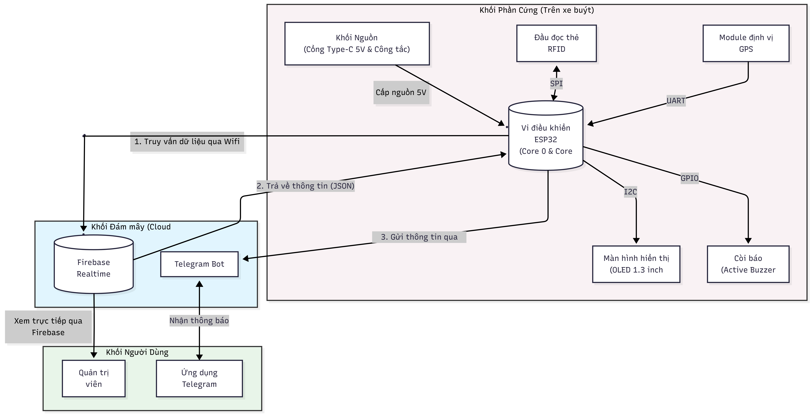
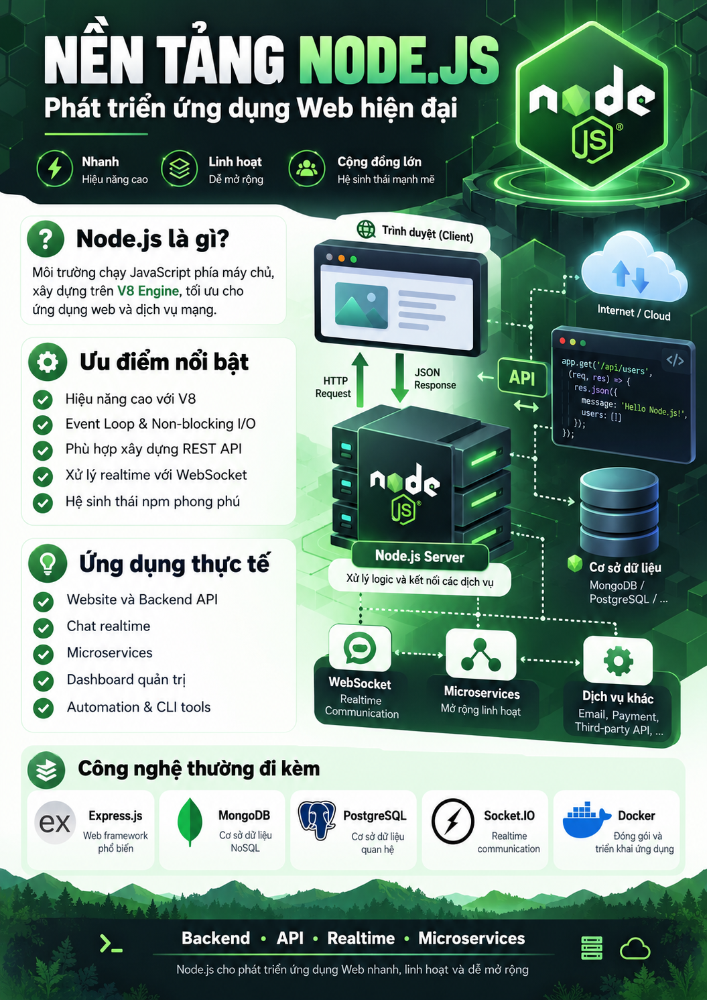

# CHƯƠNG 2. THIẾT KẾ TỔNG QUAN HỆ THỐNG

Chương này trình bày yêu cầu thiết kế và kiến trúc tổng quan của thiết bị giám sát học sinh lên xuống xe buýt đưa đón. Hệ thống được xem xét theo ba phân hệ chính: thiết bị đặt trên xe, dịch vụ lưu trữ và xử lý dữ liệu, và kênh thông báo cho người dùng. Việc phân chia thành các phân hệ giúp xác định rõ trách nhiệm, giao tiếp và phương án kiểm thử của từng thành phần.

## 2.1 Yêu cầu thiết kế hệ thống

### 2.1.1 Yêu cầu chức năng

Hệ thống cần đáp ứng các chức năng cơ bản sau:

1. Đọc mã định danh từ thẻ RFID khi người dùng đưa thẻ đến gần đầu đọc.
2. Kiểm tra mã thẻ và xác định thẻ có được đăng ký trong dữ liệu quản lý hay không.
3. Ghi nhận sự kiện lên xe hoặc xuống xe theo quy tắc trạng thái đã thiết kế.
4. Thu thập tọa độ GPS và gắn thông tin vị trí vào sự kiện khi dữ liệu định vị hợp lệ.
5. Gửi dữ liệu sự kiện lên dịch vụ lưu trữ trực tuyến thông qua kết nối mạng.
6. Gửi thông báo đến tài khoản hoặc kênh liên hệ đã được cấu hình cho phụ huynh.
7. Hiển thị hoặc báo hiệu trạng thái hoạt động, chẳng hạn như đọc thẻ thành công, thẻ chưa đăng ký hoặc mất kết nối.

### 2.1.2 Yêu cầu phi chức năng

- **Độ tin cậy:** lỗi ở một khối không nên khiến toàn bộ chương trình dừng mà không có thông báo.
- **Khả năng phản hồi:** thiết bị cần phản hồi rõ ràng sau thao tác quẹt thẻ và hạn chế thời gian chờ không cần thiết.
- **Khả năng bảo trì:** chương trình được chia thành các hàm hoặc mô-đun có trách nhiệm riêng, thuận tiện kiểm thử và sửa lỗi.
- **Bảo mật:** thông tin xác thực không nên được ghi trực tiếp vào mã nguồn công khai; quyền đọc và ghi dữ liệu cần được giới hạn.
- **Khả năng mở rộng:** có thể bổ sung thông tin học sinh, thẻ và thiết bị theo cấu trúc dữ liệu nhất quán.
- **Khả năng phục hồi:** khi mạng hoặc dịch vụ trực tuyến tạm thời không hoạt động, thiết bị cần báo trạng thái lỗi rõ ràng; chức năng lưu đệm ngoại tuyến có thể được phát triển ở giai đoạn tiếp theo.

### 2.1.3 Ràng buộc thiết kế

Thiết bị phải hoạt động trong giới hạn điện áp và dòng điện phù hợp với các module được chọn. Các giao tiếp UART, SPI hoặc I2C cần được cấu hình đúng theo tài liệu của linh kiện. Chất lượng định vị GPS phụ thuộc vào điều kiện thu tín hiệu vệ tinh; khả năng gửi thông báo phụ thuộc vào kết nối Internet và trạng thái dịch vụ bên ngoài. Do đó, không nên coi dữ liệu vị trí hoặc trạng thái gửi tin là luôn có sẵn.

## 2.2 Sơ đồ khối hệ thống và nguyên lý hoạt động

### 2.2.1 Các khối chức năng

Kiến trúc tổng quan có thể được mô tả bằng các khối sau:

- **Khối nhận dạng RFID:** đọc mã định danh của thẻ và chuyển dữ liệu cho bộ điều khiển.
- **Khối điều khiển ESP32:** xử lý sự kiện, quản lý trạng thái, điều phối dữ liệu giữa các module và thực hiện giao tiếp mạng [@esp32].
- **Khối GPS:** cung cấp dữ liệu tọa độ và thông tin liên quan đến trạng thái định vị.
- **Khối hiển thị hoặc báo trạng thái:** cung cấp phản hồi trực tiếp cho người thao tác.
- **Khối dịch vụ trực tuyến:** tiếp nhận và lưu dữ liệu sự kiện để phục vụ tra cứu, quản lý và đồng bộ [@firebase].
- **Khối thông báo:** chuyển thông tin sự kiện đến kênh liên hệ đã cấu hình cho phụ huynh.

Table: Các khối chức năng trong hệ thống
| Khối | Dữ liệu vào | Nhiệm vụ chính | Dữ liệu ra |
|---|---|---|---|
| RFID | Thẻ RFID | Đọc mã thẻ | Mã định danh |
| ESP32 | Mã thẻ, dữ liệu GPS, trạng thái mạng | Xử lý và điều phối | Bản ghi sự kiện, lệnh điều khiển |
| GPS | Tín hiệu vệ tinh | Tính toán vị trí | Tọa độ và trạng thái định vị |
| Dịch vụ dữ liệu | Yêu cầu qua mạng | Lưu trữ và cung cấp dữ liệu | Kết quả đọc/ghi |
| Dịch vụ thông báo | Nội dung sự kiện | Gửi thông tin tới người nhận | Trạng thái gửi thông báo |

### 2.2.2 Nguyên lý hoạt động

Quy trình xử lý một sự kiện điểm danh được đề xuất như sau:

1. Thiết bị khởi tạo các module, kiểm tra cấu hình và kết nối mạng.
2. Đầu đọc RFID chờ thẻ được đưa đến vùng đọc.
3. Khi đọc được mã thẻ, ESP32 kiểm tra mã đó với dữ liệu đã cấu hình hoặc dữ liệu nhận từ dịch vụ trực tuyến.
4. Nếu thẻ hợp lệ, chương trình xác định loại sự kiện theo quy tắc trạng thái của học sinh và tạo bản ghi gồm mã học sinh, thời điểm, trạng thái và tọa độ nếu có.
5. Thiết bị gửi bản ghi lên dịch vụ dữ liệu. Kết quả gửi cần được kiểm tra để tránh thông báo thành công khi máy chủ chưa xác nhận.
6. Sau khi có đủ dữ liệu cần thiết, hệ thống yêu cầu gửi thông báo đến người nhận đã đăng ký.
7. Thiết bị phản hồi kết quả bằng màn hình, đèn hoặc âm báo phù hợp.

Nếu thẻ không hợp lệ, hệ thống không tạo sự kiện điểm danh chính thức và thông báo cho người vận hành. Nếu mất mạng, thiết bị cần hiển thị trạng thái không kết nối. Phiên bản cơ bản có thể yêu cầu thao tác lại sau khi kết nối được khôi phục; cơ chế lưu và gửi bù dữ liệu ngoại tuyến cần được thiết kế, kiểm thử riêng trước khi sử dụng thực tế.

### 2.2.3 Luồng dữ liệu và trạng thái

Một bản ghi sự kiện có thể bao gồm mã học sinh, mã thiết bị, thời gian ghi nhận, loại sự kiện, tọa độ GPS và trạng thái đồng bộ. Các trường dữ liệu nên được đặt tên thống nhất giữa chương trình nhúng và dịch vụ trực tuyến để hạn chế lỗi khi trao đổi dữ liệu.

Trạng thái lên xe hoặc xuống xe cần được xác định bằng một quy tắc rõ ràng. Ví dụ, hệ thống có thể lưu trạng thái gần nhất của mỗi học sinh và chuyển trạng thái khi phát sinh sự kiện hợp lệ tiếp theo. Cách làm này cần có cơ chế chống đọc lặp trong khoảng thời gian ngắn để tránh tạo nhiều bản ghi từ một lần đưa thẻ vào đầu đọc.

## 2.3 Lựa chọn giải pháp công nghệ và linh kiện phần cứng

### 2.3.1 Phân hệ Device

ESP32 được lựa chọn làm bộ điều khiển trung tâm do có khả năng xử lý dữ liệu ngoại vi và hỗ trợ kết nối Wi-Fi trong cùng một nền tảng [@esp32]. Khi thiết kế, cần kiểm tra số chân GPIO khả dụng, mức điện áp logic, yêu cầu dòng điện và sự tương thích giữa các module.

Đầu đọc RFID đảm nhiệm việc đọc mã định danh từ thẻ. Trong giai đoạn nguyên mẫu, cần xác nhận loại thẻ tương thích, khoảng cách đọc thực tế và cách xử lý trường hợp đọc lặp. Mã thẻ chỉ nên được dùng để tra cứu bản ghi tương ứng trong hệ thống; không nên xem mã thẻ đơn lẻ là cơ chế bảo mật tuyệt đối.

Module GPS cung cấp tọa độ khi thiết bị nhận được tín hiệu vệ tinh đủ điều kiện. Chương trình cần kiểm tra trạng thái dữ liệu trước khi đính kèm tọa độ vào thông báo. Khi chưa có vị trí hợp lệ, bản ghi nên biểu thị rõ rằng dữ liệu GPS chưa sẵn sàng thay vì sử dụng tọa độ cũ như vị trí hiện tại.

Nguồn cấp cần được thiết kế phù hợp với điện áp hoạt động của ESP32 và từng module. Cần tính đến dòng tiêu thụ, nhiễu nguồn, đầu nối và khả năng cố định thiết bị khi lắp đặt trên xe. Các thông số cụ thể phải được xác nhận theo datasheet của linh kiện thực tế được sử dụng.

### 2.3.2 Phân hệ Server – Backend

Dịch vụ dữ liệu trực tuyến có nhiệm vụ lưu trữ thông tin học sinh, mã thẻ, cấu hình người nhận và lịch sử sự kiện. Firebase Realtime Database là một lựa chọn để lưu trữ dữ liệu dạng cây và đồng bộ qua mạng [@firebase]. Cấu trúc dữ liệu cần được thiết kế sao cho có thể tra cứu theo mã học sinh, mã thẻ hoặc thời gian mà không phải tải toàn bộ dữ liệu không cần thiết.

Thông tin xác thực và quy tắc phân quyền cần được cấu hình cẩn thận. Không nên triển khai cơ sở dữ liệu với quyền đọc và ghi công khai trong môi trường vận hành thực tế. Các khóa hoặc token dùng để kết nối dịch vụ cần được bảo vệ và không đưa vào kho mã nguồn chia sẻ.

Phân hệ thông báo sử dụng API của dịch vụ nhắn tin để chuyển sự kiện đến đúng người nhận. Dữ liệu người nhận phải được kiểm tra và quản lý bởi người có quyền. Nếu yêu cầu gửi tin thất bại, hệ thống cần ghi nhận kết quả lỗi để hỗ trợ kiểm tra; không nên khẳng định thông báo đã đến điện thoại chỉ dựa trên việc gửi yêu cầu thành công.

### 2.3.3 Phân hệ App và người dùng

Trong phạm vi nguyên mẫu, giao diện người dùng có thể được triển khai thông qua kênh thông báo và công cụ quản lý dữ liệu trực tuyến. Phụ huynh nhận thông báo về sự kiện đã ghi nhận; người quản lý cập nhật dữ liệu học sinh, liên kết mã thẻ và kiểm tra lịch sử.

Giao diện cần trình bày thông tin ngắn gọn, tránh hiển thị dữ liệu cá nhân không cần thiết và phân biệt rõ thời điểm ghi nhận với thời điểm nhận thông báo. Nếu vị trí GPS không hợp lệ hoặc chưa cập nhật, giao diện cần thể hiện trạng thái đó thay vì hiển thị thông tin gây hiểu nhầm.

## 2.4 Yêu cầu chức năng của các phân hệ phụ

### 2.4.1 Quản lý dữ liệu học sinh và thẻ

Mỗi học sinh cần có mã định danh nội bộ ổn định. Mã thẻ RFID được liên kết với bản ghi học sinh thông qua cấu hình quản lý. Hệ thống cần xử lý được các trường hợp thẻ chưa đăng ký, thẻ bị vô hiệu hóa hoặc một mã thẻ bị liên kết nhầm với nhiều bản ghi.

### 2.4.2 Ghi nhận và tra cứu sự kiện

Mỗi sự kiện cần lưu các trường tối thiểu gồm mã học sinh, thời gian, loại sự kiện và trạng thái xử lý. Tọa độ chỉ được lưu khi dữ liệu định vị đạt điều kiện hợp lệ. Dữ liệu cần hỗ trợ tra cứu lịch sử để người vận hành đối chiếu khi có sai khác.

### 2.4.3 Gửi thông báo

Thông báo cần nêu rõ sự kiện nào được ghi nhận và thời điểm xảy ra. Khi có tọa độ hợp lệ, có thể bổ sung thông tin vị trí hoặc liên kết bản đồ. Nội dung gửi phải được giới hạn ở mức cần thiết, đồng thời bảo đảm thông tin được gửi đến đúng tài khoản đã cấu hình.

### 2.4.4 Xử lý lỗi và khôi phục

test thử 

## 2.5 Kết luận chương

Chương 2 đã xác định các yêu cầu chức năng, yêu cầu phi chức năng và những ràng buộc chính của hệ thống. Kiến trúc được chia thành thiết bị đầu cuối, dịch vụ dữ liệu và kênh thông báo nhằm tách biệt nhiệm vụ và thuận tiện cho kiểm thử. Các lựa chọn công nghệ ở chương này là cơ sở cho thiết kế phần cứng, triển khai chương trình nhúng và xây dựng luồng dữ liệu ở các chương tiếp theo. Những thông số hiệu năng và độ chính xác sẽ được xác nhận bằng thực nghiệm, không được giả định trước khi đo kiểm.
