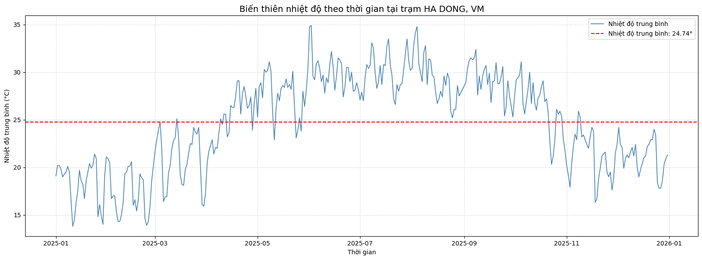

# CHƯƠNG 3. THỰC NGHIỆM VÀ PHÂN TÍCH KẾT QUẢ

## 3.1 Dữ liệu thực nghiệm từ NOAA GHCN
Dữ liệu được khai thác từ cơ sở dữ liệu của **Cơ quan Quản lý Khí quyển và Đại dương Quốc gia Hoa Kỳ (NOAA)** cung cấp miễn phí qua dự án **Global Historical Climatology Network (GHCN)**. Đây là nguồn dữ liệu lịch sử chuẩn hóa toàn cầu thu thập từ hàng ngàn trạm khí tượng trên khắp thế giới.

Trong nghiên cứu này, tệp dữ liệu `weather_data.csv` bao gồm 16 trạm khí hậu đại diện cho toàn bộ lãnh thổ Việt Nam trong năm 2025.

Table: Danh sách 16 trạm quan trắc khí hậu trong nghiên cứu

| STT | Mã trạm | Tên trạm quan trắc | Vĩ độ (°N) | Kinh độ (°E) | Miền địa lý |
| :---: | :---: | :--- | :---: | :---: | :--- |
| 1 | VMM00048808 | CAO BANG, VM | 22.667 | 106.250 | Đông Bắc Bộ |
| 2 | VMM00048810 | LANG SON, VM | 21.833 | 106.767 | Đông Bắc Bộ |
| 3 | VMM00048815 | SON LA, VM | 21.333 | 103.900 | Tây Bắc Bộ |
| 4 | VMM00048820 | NOIBAI INTERNATIONAL, VM | 21.217 | 105.800 | Đồng bằng Bắc Bộ |
| 5 | VMM00048825 | HA DONG, VM | 20.967 | 105.767 | Đồng bằng Bắc Bộ |
| 6 | VMM00048826 | PHU LIEN, VM | 20.800 | 106.633 | Ven biển Bắc Bộ |
| 7 | VMM00048830 | THANH HOA, VM | 19.750 | 105.783 | Bắc Trung Bộ |
| 8 | VMM00048840 | VINH, VM | 18.667 | 105.667 | Bắc Trung Bộ |
| 9 | VMM00048845 | DONG HOI, VM | 17.483 | 106.633 | Bắc Trung Bộ |
| 10 | VMM00048852 | DANANG INTERNATIONAL, VM | 16.033 | 108.200 | Nam Trung Bộ |
| 11 | VMM00048855 | MARBLE MOUNTAIN, VM | 16.033 | 108.250 | Nam Trung Bộ |
| 12 | VMM00048870 | QUI NHON, VM | 13.767 | 109.217 | Nam Trung Bộ |
| 13 | VMM00048887 | PHAN THIET, VM | 10.933 | 108.100 | Duyên hải Cực Nam Trung Bộ |
| 14 | VMM00048900 | TAN SON HOA, VM | 10.800 | 106.667 | Nam Bộ |
| 15 | VMM00048914 | CA MAU, VM | 9.183 | 105.150 | Tây Nam Bộ |
| 16 | VMM00048918 | PHU QUOC, VM | 10.217 | 103.967 | Hải đảo Nam Bộ |

## 3.2 Phân tích chuỗi thời gian nhiệt độ trạm Hà Đông
Để hiểu rõ tính chất chu kỳ và biên độ dao động nhiệt của khu vực khí hậu Bắc Bộ, chuỗi thời gian nhiệt độ trung bình tại trạm **HA DONG, VM** được trích xuất và phân tích.

Kết quả thống kê mô tả chuỗi thời gian nhiệt độ tại trạm Hà Đông:
- **Số ngày ghi nhận:** 365 ngày (năm 2025 hoàn chỉnh).
- **Nhiệt độ trung bình năm:** 24.74 °C (được biểu thị bằng đường đứt nét màu đỏ).
- **Nhiệt độ cao nhất:** 34.80 °C (ghi nhận vào đợt nắng nóng đỉnh điểm tháng 6/2025).
- **Nhiệt độ thấp nhất:** 13.80 °C (ghi nhận vào đợt không khí lạnh mạnh tháng 1/2025).

**Nhận xét vật lý khí tượng:**
Biểu đồ chuỗi thời gian phản ánh rõ nét đặc trưng khí hậu nhiệt đới gió mùa có mùa đông lạnh của miền Bắc. Từ tháng 1 đến tháng 3, nhiệt độ dao động mạnh quanh mức 14 – 20 °C dưới tác động của các đợt gió mùa Đông Bắc. Giai đoạn từ tháng 5 đến tháng 8, nhiệt độ tăng cao vượt mức 30 °C và duy trì ổn định. Sự tương phản theo mùa rõ rệt này là nhân tố quyết định độ đồng pha mạnh giữa các trạm phía Bắc.

## 3.3 Phân tích cấu trúc mạng lưới khí hậu tổng thể
Sau khi áp dụng ngưỡng tương quan $\theta = 0.8$, mạng lưới gồm 16 nút được trực quan hóa trên sơ đồ tròn.

**Đặc điểm không gian của đồ thị:**
1. **Khối liên thông lớn (Giant Component):** Gồm 12 trạm thuộc miền Bắc và miền Trung (từ Cao Bằng, Lạng Sơn kéo dài vào tới Quy Nhơn). Mạng lưới này có mật độ cạnh dày đặc, hệ số tương quan giữa các trạm trong khu vực đa phần đều đạt mức rất cao từ 0.82 đến 0.98.
2. **Hiện tượng các nút cô lập (Isolated Nodes):** Có 4 trạm hoàn toàn không hình thành liên kết nào trong mạng lưới ($C_D = 0$):
   - **PHAN THIET, VM**
   - **TAN SON HOA, VM**
   - **PHU QUOC, VM**
   - **CA MAU, VM**

**Giải thích nguyên nhân khí tượng:**
Cả 4 trạm bị cô lập đều thuộc khu vực Nam Trung Bộ và Nam Bộ. Về mặt địa lý và khí hậu học, khu vực này nằm trong đới khí hậu cận xích đạo gió mùa, có nền nhiệt độ cao quanh năm (dao động nhiệt độ ngày và mùa rất nhỏ, không có mùa đông lạnh). Biến thiên nhiệt độ của Nam Bộ không đồng pha với các đợt rét tràn về phía Bắc, dẫn đến hệ số tương quan tuyến tính $r_{ij} < 0.8$. Kết quả của mô hình mạng lưới đã phản ánh trung thực ranh giới phân hóa khí hậu tự nhiên qua dãy Bạch Mã.

## 3.4 Phân tích các chỉ số đo lường trung tâm

### 3.4.1 Degree Centrality - Trạm khí hậu phổ biến
Chỉ số bậc chuẩn hóa phản ánh mức độ kết nối của từng trạm với các trạm khác trên toàn quốc.

Table: Top 3 trạm thời tiết có Degree Centrality cao nhất

| Hạng | Tên trạm quan trắc | Degree Centrality | Tỉ lệ kết nối |
| :---: | :--- | :---: | :---: |
| 1 | THANH HOA, VM | 0.67 | 10 / 15 trạm |
| 2 | DONG HOI, VM | 0.60 | 9 / 15 trạm |
| 3 | HA DONG, VM | 0.60 | 9 / 15 trạm |

**Ý nghĩa:** 
Trạm Thanh Hóa giữ vị trí số một với $C_D = 0.67$, tiếp theo là Đồng Hới và Hà Đông ($C_D = 0.60$). Điều này chứng minh Thanh Hóa và Đồng Hới là vùng đệm khí hậu bản lề giữa Bắc Bộ và Trung Bộ, vừa chịu ảnh hưởng trực tiếp của không khí lạnh phương Bắc vừa phản ánh biến động thời tiết ven biển, đóng vai trò đại diện tiêu biểu nhất cho động thái nhiệt độ của toàn mạng lưới.

### 3.4.2 Betweenness Centrality - Trạm cầu nối khí hậu
Chỉ số trung gian xác định các nút điều tiết luồng thông tin hoặc các mắt xích liên kết giữa các cụm khí hậu.

Table: Top 3 trạm có Betweenness Centrality cao nhất

| Hạng | Tên trạm quan trắc | Betweenness Centrality | Vai trò cấu trúc |
| :---: | :--- | :---: | :--- |
| 1 | NOIBAI INTERNATIONAL, VM | 0.05 | Cầu nối liên cụm trọng yếu |
| 2 | THANH HOA, VM | 0.03 | Cầu nối chuyển tiếp Bắc - Trung |
| 3 | VINH, VM | 0.03 | Cầu nối khu vực Trung Bộ |

**Ý nghĩa:**
Trạm Nội Bài đạt chỉ số cao nhất ($C_B = 0.05$), theo sau là Thanh Hóa và Vinh ($C_B = 0.03$). Trong cấu trúc liên kết, Nội Bài đóng vai trò cửa ngõ truyền dẫn tương quan giữa các trạm miền núi phía Bắc (Sơn La, Cao Bằng) với các trạm duyên hải miền Trung (Đà Nẵng, Quy Nhơn). Đây là những vị trí quan sát chiến lược: mọi biến đổi dị thường tại các trạm này sẽ nhanh chóng phản ánh sang các cụm lân cận.

### 3.4.3 Clustering Coefficient - Vùng lõi khí hậu đồng nhất
Hệ số gom cụm cho biết mức độ liên kết nội tại của các tiểu vùng khí hậu.

Table: Top 3 trạm có Clustering Coefficient cao nhất

| Hạng | Tên trạm quan trắc | Clustering Coefficient | Đặc điểm tiểu vùng |
| :---: | :--- | :---: | :--- |
| 1 | SON LA, VM | 1.00 | Vùng núi Tây Bắc cô đọng |
| 2 | QUI NHON, VM | 1.00 | Cụm Duyên hải Nam Trung Bộ |
| 3 | CAO BANG, VM | 0.89 | Cụm vùng cao Đông Bắc |

**Ý nghĩa:**
Sơn La và Quy Nhơn đạt hệ số tuyệt đối ($C = 1.00$), Cao Bằng đạt mức rất cao ($C = 0.89$). Tất cả các lân cận của Sơn La và Quy Nhơn trong mạng đều liên kết chéo với nhau tạo thành các tam giác hoàn chỉnh (clique). Điều này phản ánh tính chất khí hậu cục bộ rất thuần nhất: các trạm này nằm ở vùng lõi khí hậu đặc trưng, không bị phân tán bởi nhiều nguồn nhiễu động ngoại vi.

### 3.4.4 Edge Betweenness Centrality - Các liên kết tương quan huyết mạch
Mức độ trung gian cạnh phát hiện các liên kết giữ vai trò "hành lang" kết nối giữa hai vùng khí hậu.

Table: Top 3 cạnh có Edge Betweenness Centrality cao nhất

| Hạng | Cặp trạm liên kết | Edge Betweenness | Phân loại liên kết |
| :---: | :--- | :---: | :--- |
| 1 | NOIBAI INTERNATIONAL, VM <-> QUI NHON, VM | 0.0396 | Liên kết liên vùng Bắc - Nam Trung Bộ |
| 2 | MARBLE MOUNTAIN, VM <-> DANANG INTERNATIONAL, VM | 0.0307 | Cặp trạm vi khí hậu cục bộ |
| 3 | QUI NHON, VM <-> VINH, VM | 0.0264 | Trục liên kết hành lang duyên hải |

**Ý nghĩa:**
- Cạnh **NOIBAI INTERNATIONAL <-> QUI NHON** có $C_B(e) = 0.0396$, cao nhất mạng lưới. Đây chính là liên kết đường dài (long-range connection) bắc cầu giữa cụm đồng bằng Bắc Bộ và cực nam của khối liên thông (Quy Nhơn).
- Cặp cạnh **MARBLE MOUNTAIN <-> DANANG INTERNATIONAL** ($C_B(e) = 0.0307$) thể hiện mối tương tác cục bộ cực kỳ mạnh mẽ giữa hai trạm cùng một thành phố biển Đà Nẵng, nhưng giữ vai trò chốt chặn chuyển giao tín hiệu vào dải miền Trung.
- Tuyến **QUI NHON <-> VINH** ($C_B(e) = 0.0264$) là trục kết nối ven biển quan trọng chi phối sự truyền dẫn nhiệt độ dọc theo dải duyên hải miền Trung.
